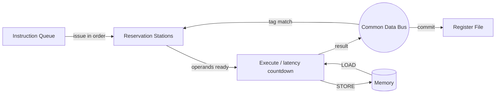

# Tomasulo Algorithm Simulator

> Out-of-order execution simulator with a Tkinter GUI: register renaming, reservation stations, a Common Data Bus, and instruction-level parallelism.

Built as part of a Computer Architecture course at The American University in Cairo.

---

## Table of Contents

1. [Overview](#overview)
2. [Features](#features)
3. [Background: Tomasulo's Algorithm](#background-tomasulos-algorithm)
4. [Architecture of the Simulated Machine](#architecture-of-the-simulated-machine)
5. [Instruction Set](#instruction-set)
6. [Input File Formats](#input-file-formats)
7. [Installation](#installation)
8. [Usage](#usage)
9. [GUI Guide](#gui-guide)
10. [Simulation Pipeline (Per Cycle)](#simulation-pipeline-per-cycle)
11. [Code Walkthrough](#code-walkthrough)
12. [Sample Programs](#sample-programs)
13. [Performance Metrics](#performance-metrics)
14. [Known Limitations](#known-limitations)
15. [Troubleshooting](#troubleshooting)
16. [Repository Structure](#repository-structure)
17. [Authors](#authors)

---

## Overview

This project simulates a processor that uses **Tomasulo's algorithm** for dynamic scheduling. Instructions are issued in order to reservation stations, execute out of order as soon as their operands are available, and broadcast results on a single Common Data Bus (CDB). Register renaming through reservation-station tags removes WAR and WAW hazards. The simulator can be run headless from Python or through a GUI that shows each cycle.

## Features

- **Out-of-order execution** with operand-ready triggered start.
- **Register renaming** through reservation-station tags (`Qj`/`Qk`) and a register status table.
- **Per-unit latencies** for loads, stores, adds, multiplies, NORs, branches and calls.
- **Single Common Data Bus** with contention: only one result is broadcast per cycle, so other finished units wait.
- **Tkinter GUI** with five tabs: control, status, timing diagram, memory viewer and statistics.
- **Matplotlib charts**: instruction timing diagram and functional-unit utilization.
- **Plain-text program and memory files**, with `#` comments.
- **Four sample programs** and a sample memory file.
- **Headless mode**: `simulator.py` can be run on its own.

## Background: Tomasulo's Algorithm

Tomasulo's algorithm was introduced in the IBM System/360 Model 91. Its core ideas are:

| Concept | Role |
|---|---|
| **Reservation stations** | Buffer instructions and operands next to each functional unit. |
| **Register renaming** | A register that is waiting on a result holds the *tag* of the producing station instead of a value. |
| **Common Data Bus** | Broadcasts `(tag, value)`. Every waiting station snoops it and captures matching operands. |
| **Dynamic scheduling** | An instruction starts executing when all its operands are present, regardless of program order. |

An instruction goes through three phases:

1. **Issue**: take the next instruction in program order and allocate a free reservation station of the right type. Read ready operands, or record the tag of the producer. Claim the destination register.
2. **Execute**: once both operands are available, count down the unit's latency.
3. **Write result**: broadcast on the CDB, update the register file, and free the station.

## Architecture of the Simulated Machine

### Registers

- Registers `r0`–`r7` (8 registers, created in [`RegisterBank`](memory.py)).
- `r0` is hard-wired to **0**. Reads return 0 and writes are ignored.
- `r1` is used implicitly as the **return address** register: `CALL` writes it, `RET` reads it.
- Each register has a value, a *reserved* flag and a *tag* (name of the station that will write it).

### Memory

- `MemoryArray`: **65,536 word cells**, all initialised to 0.
- Addresses are word indexes, not byte addresses. `LOAD r1, 4(r2)` reads cell `r2 + 4`.

### Reservation stations and functional units

Defined in [`simulator.py`](simulator.py) (`TomasuloSimulator.__init__`):

| Group | Stations | Count | Latency (cycles) |
|---|---|---|---|
| Load | `LRS1`, `LRS2` | 2 | 6 |
| Store | `SRS1`, `SRS2` | 2 | 6 |
| Branch (`BEQ`) | `BEQ1`, `BEQ2` | 2 | 1 |
| Call/Return | `CALL_RET1` | 1 | 1 |
| Add/Sub | `ADD_SUB1`, `ADD_SUB2` | 2 | 2 |
| NOR | `NOR1` | 1 | 1 |
| Multiply | `MUL1` | 1 | 10 |

Latencies and unit counts are set in one place in `TomasuloSimulator.__init__`. Edit the `ReservationUnit(name, type, latency)` calls to try other configurations.

### Common Data Bus

[`ResultBus`](memory.py) holds one `(value, source_tag, destination)` triple per cycle. If a unit finishes while the bus is occupied, it sets `pending_broadcast` and retries on a later cycle.

## Instruction Set

| Instruction | Syntax | Semantics |
|---|---|---|
| `LOAD` | `LOAD rA, offset(rB)` | `rA = MEM[rB + offset]` |
| `STORE` | `STORE rA, offset(rB)` | `MEM[rB + offset] = rA` |
| `ADD` | `ADD rD, rS, rT` or `ADD rD, rS, imm` | `rD = rS + rT/imm` |
| `SUB` | `SUB rD, rS, rT` or `SUB rD, rS, imm` | `rD = rS - rT/imm` |
| `MUL` | `MUL rD, rS, rT` or `MUL rD, rS, imm` | `rD = (rS * rT/imm) & 0xFFFF` (low 16 bits) |
| `NOR` | `NOR rD, rS, rT` or `NOR rD, rS, imm` | `rD = ~(rS \| rT/imm)` |
| `BEQ` | `BEQ rS, rT, offset` | If `rS == rT`, `PC = PC + 1 + offset`, else `PC + 1` |
| `CALL` | `CALL target` | `r1 = PC + 1`, then `PC = target` |
| `RET` | `RET` | `PC = r1` |

Syntax notes:

- Opcodes are case-insensitive. Registers are written lowercase (`r0`..`r7`).
- Commas between operands are optional (they are stripped by the parser).
- Immediates are plain integers (`ADD r1, r0, 10`). Negative values are allowed.
- `#` starts a comment, which can be on its own line or at the end of a line.
- Lines that cannot be parsed are silently skipped by [`parse_instruction`](parser.py).

## Input File Formats

### Program file (`program*.txt`)

One instruction per line:

```text
ADD r1, r0, 10    # r1 = 10
ADD r2, r0, 20    # r2 = 20
STORE r1, 0(r2)   # mem[20] = 10
LOAD  r4, 0(r2)   # r4 = mem[20]
```

### Memory data file (`data.txt`)

Each line is `address value` (decimal, whitespace separated). Blank lines and lines starting with `#` are ignored:

```text
10 42
11 73
12 15
```

The memory file is optional. Without it, all memory is 0.

## Installation

### Requirements

- Python **3.8+** (developed on 3.11)
- `tkinter` (bundled with the standard Python installers for Windows and macOS. On Debian/Ubuntu run `sudo apt install python3-tk`.)
- `matplotlib` and `numpy` (used by the GUI charts)

### Setup

```bash
git clone <your-repo-url>
cd Tomasulo-Algorithm-Simulation

# optional but recommended
python -m venv .venv
# Windows:      .venv\Scripts\activate
# macOS/Linux:  source .venv/bin/activate

pip install -r requirements.txt
```

## Usage

### GUI

```bash
python main.py
```

Typical workflow:

1. Choose a **Program File** (e.g. `program1.txt`) using **Browse...**.
2. Optionally choose a **Memory File** (e.g. `data.txt`).
3. Click **Initialize**. The program is parsed and shown in the program pane.
4. Click **Step** to advance one clock cycle, or **Run All** to simulate to completion.
5. Open the other tabs to inspect state, timing, memory and statistics.
6. Click **Reset** to start over.

### Headless

[`simulator.py`](simulator.py) contains a `__main__` block that runs `program.txt` to completion:

```bash
python simulator.py
```

Or use it from your own code:

```python
from simulator import TomasuloSimulator

sim = TomasuloSimulator()
sim.load_program("program1.txt")
sim.load_memory_data("data.txt")   # optional
sim.simulate()

sim.display_timing_table()
sim.display_register_status()
print("Cycles:", sim.total_cycle)
print("IPC:", sim.calculate_ipc())
```

To advance one cycle at a time:

```python
sim.total_cycle += 1
sim.handle_writeback()
sim.handle_execution()
sim.issue_instruction()
```

## GUI Guide

The interface uses a dark-slate studio layout with a persistent top header bar (showing live **Status**, **Cycle**, **Completed**, **IPC**, **Branch Accuracy**, and **In Queue** KPI cards) and a control toolbar for selecting program/memory files and running **Initialize**, **Step Cycle**, **Run All**, and **Reset**.

| Tab | Contents |
|---|---|
| **Live Execution Dashboard** | Side-by-side view of the assembly program source, cycle event log, Common Data Bus (CDB) broadcast banner, color-coded Reservation Stations table, and structured Register File & Rename Tags table. |
| **Timing Diagram & Utilization** | Side-by-side Matplotlib charts showing the Instruction Pipeline Timing Diagram (Issue, Execute, Writeback) and Functional Unit Utilization percentages. |
| **Memory Inspector** | Inspect word memory ranges with quick-range buttons, a *Non-zero cells only* filter, and Decimal, Hex, 16-bit Binary, and ASCII representations. |

## Simulation Pipeline (Per Cycle)

`TomasuloSimulator.simulate()` runs the following loop until the instruction queue is empty and every station is free. It stops after 1000 cycles as a safeguard.

```text
total_cycle += 1
1. handle_writeback()     # stations snoop CDB, CDB is cleared, one finished station commits
2. handle_execution()     # every station steps: start, count down, complete, broadcast on the CDB
3. issue_instruction()    # issue the head of the instruction queue if a matching station is free
```



Per-instruction timing is stored in `instruction_timing[instr]` with the keys `issue`, `execute_start`, `execute_complete` and `writeback`.

## Code Walkthrough

| File | Purpose |
|---|---|
| [`main.py`](main.py) | Creates the Tk root, builds `TomasuloGUI(root, TomasuloSimulator)` and starts the main loop. |
| [`simulator.py`](simulator.py) | `TomasuloSimulator`: owns memory, registers, the instruction queue, the stations and the CDB. Implements issue, execute and write-back, program/memory loading and metrics. |
| [`units.py`](units.py) | `ReservationUnit`: one station plus its functional unit. Handles operand capture (`allocate`, `listen`), readiness (`is_ready_to_execute`), execution (`step`) and commit. |
| [`memory.py`](memory.py) | `MemoryArray` (65,536 cells), `RegisterBank` (values, reserved flags, tags) and `ResultBus` (the CDB). |
| [`parser.py`](parser.py) | `Instruction` data class and `parse_instruction()` for text-to-instruction conversion. |
| [`gui.py`](gui.py) | `TomasuloGUI`: the Tkinter and Matplotlib front end. |

### Key `ReservationUnit` fields

| Field | Meaning |
|---|---|
| `busy` | Station is in use. |
| `opcode`, `dest` | Operation and destination register. |
| `vj`, `vk` | Operand values, once known. |
| `qj`, `qk` | Tags of the stations that will produce the operands, or `None` if ready. |
| `remaining_cycles` | Latency countdown. |
| `pending_broadcast` | Result is ready but the CDB was busy. |
| `ready_to_commit` | Result broadcast, waiting to write back. |

## Sample Programs

| File | Demonstrates |
|---|---|
| `program.txt` | Short mix of `ADD`, `STORE`, `LOAD`, `SUB`, `NOR` and `RET`. Shows a RAW chain through memory. |
| `program1.txt` | Register initialisation, store/load pairs, `ADD`/`MUL`/`SUB`/`NOR` dependency chains and a taken `BEQ`. |
| `program2.txt` | Array setup in memory, a sum loop with `BEQ`, and `CALL`/`RET`. |
| `program3.txt` | Independent and dependent operations, a forward branch, a loop and `CALL`/`RET`. |
| `data.txt` | Example memory image: cells 10, 11 and 12 hold 42, 73 and 15. |

> [!NOTE]
> Some samples (for example `program1.txt`) use registers above `r7`. See [Known Limitations](#known-limitations).

## Performance Metrics

Computed in `TomasuloSimulator`:

| Metric | Formula |
|---|---|
| **Total cycles** | `total_cycle` |
| **Instructions completed** | Incremented once per committed instruction. |
| **IPC** | `instructions_completed / total_cycle` (`calculate_ipc`) |
| **Branches encountered** | Count of `BEQ` instructions that changed the PC. |
| **Branch prediction accuracy** | `(branches - mispredictions) / branches * 100`, or 100% if no branches (`get_branch_prediction_accuracy`). |

## Known Limitations

Documented here so results are interpreted correctly:

- **Register count**: `RegisterBank` defaults to 8 registers (`r0`–`r7`), but some sample programs write `r8`. Raise the count with `RegisterBank(registers=16)` in `simulator.py` if you hit a `KeyError`.
- **`requirements.txt`**: if it is not present, install the dependencies manually: `pip install matplotlib numpy`.
- **In-order fetch queue**: instructions are issued from a queue built when the program is loaded. A `BEQ`/`CALL`/`RET` updates the simulated `pc`, but control flow does not re-fetch from the new PC, so loops and calls do not actually repeat or redirect the queue.
- **No speculation**: there is no branch predictor or reorder buffer. The prediction accuracy figure is only a statistic of PC changes.
- **Issue stalls**: issue is strictly in order, one instruction per cycle, and blocks when no matching station is free.
- **Memory bounds**: addresses outside 0–65535 raise a Python `IndexError`. Memory-file errors cause `load_memory_data` to return `False`.
- **Safety cap**: simulation stops after 1000 cycles.
- **16-bit multiply**: `MUL` masks to 16 bits; the other operations are unbounded Python integers.

## Troubleshooting

| Problem | Fix |
|---|---|
| `ModuleNotFoundError: tkinter` | Install Tk: `sudo apt install python3-tk` (Linux) or reinstall Python with the *tcl/tk* option. |
| `ModuleNotFoundError: matplotlib` / `numpy` | `pip install matplotlib numpy` |
| `KeyError: 'r8'` | The program uses a register outside `r0`–`r7`. See [Known Limitations](#known-limitations). |
| Instruction ignored | The parser skips lines it cannot parse. Check the spelling and the operand count. |
| Memory file has no effect | Each line must be `address value` using integers. `load_memory_data` returns `False` on error. |
| GUI does not open over SSH/WSL | Tkinter needs a display (use an X server or run natively). |

## Repository Structure

```text
.
├── main.py           # Entry point: launches the GUI
├── simulator.py      # Core Tomasulo simulation engine
├── units.py          # Reservation stations / functional units
├── memory.py         # Memory, register bank and Common Data Bus
├── parser.py         # Instruction parser
├── gui.py            # Tkinter + Matplotlib interface
├── data.txt          # Sample memory contents
├── program.txt       # Sample program
├── program1.txt      # Test program 1
├── program2.txt      # Test program 2
├── program3.txt      # Test program 3
├── requirements.txt  # Python dependencies
└── README.md
```

## Authors

Original authors:

- **Omar Abdelhady**: [@3-bhd](https://github.com/3-bhd)
- **Muhammad Yasser Elghazaly**: [@my612](https://github.com/my612)

Maintained by:

- **Mennatallah Essam**: [@mennatallahessam](https://github.com/mennatallahessam) (GUI redesign, display bug fixes, README, and repository maintenance)

The American University in Cairo, Computer Architecture Course
