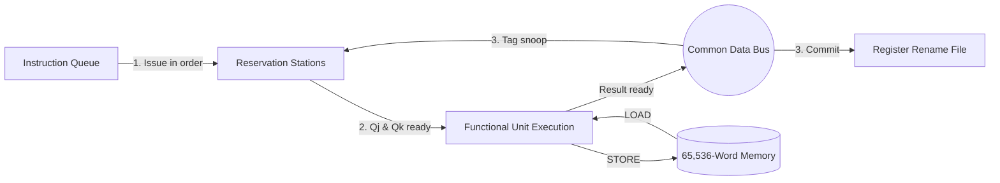

# Tomasulo Execution Studio — Out-of-Order Architecture Simulator

> Interactive Web & Node.js simulator for **Tomasulo's dynamic instruction scheduling algorithm** featuring register renaming (`Qi`), reservation stations (`Vj`, `Vk`, `Qj`, `Qk`), a single-broadcast Common Data Bus (CDB), HTML5 pipeline waterfall visualization, and a command-line test runner.

Built for the Computer Architecture course at The American University in Cairo.

---

## Table of Contents

1. [Overview](#overview)
2. [Key Features](#key-features)
3. [Background: Tomasulo's Algorithm](#background-tomasulos-algorithm)
4. [Simulated Microarchitecture](#simulated-microarchitecture)
5. [Instruction Set Architecture (ISA)](#instruction-set-architecture-isa)
6. [Input File Formats](#input-file-formats)
7. [Quick Start (Web Studio & CLI)](#quick-start-web-studio--cli)
8. [Web Studio Interface Guide](#web-studio-interface-guide)
9. [Per-Cycle Pipeline Execution](#per-cycle-pipeline-execution)
10. [Issue Modes: Queue Mode vs. PC Control-Flow Mode](#issue-modes-queue-mode-vs-pc-control-flow-mode)
11. [Customizing Functional Unit Latencies](#customizing-functional-unit-latencies)
12. [Codebase Architecture](#codebase-architecture)
13. [Sample Programs](#sample-programs)
14. [Performance Metrics](#performance-metrics)
15. [Automated Test Suite (`test.js`)](#automated-test-suite-testjs)
16. [CI/CD & GitHub Pages Deployment](#cicd--github-pages-deployment)
17. [Repository Structure](#repository-structure)
18. [Author](#author)

---

## Overview

**Tomasulo Execution Studio** models a dynamically scheduled processor implementing **Tomasulo's out-of-order execution algorithm**. Instructions are fetched and issued in program order to functional-unit reservation stations, execute out of order as soon as their source operands are ready, and broadcast results over a contended **Common Data Bus (CDB)**. Register renaming via reservation-station tags eliminates false data dependencies (WAR and WAW hazards) while preserving true data dependencies (RAW).

The simulator is implemented in modular ES2022 JavaScript and runs both as:
- An **interactive browser studio** ([`index.html`](index.html)) with real-time hardware tables, register rename cards, an HTML5 Canvas pipeline waterfall diagram, and a memory inspector.
- A **headless Node.js CLI** ([`cli.js`](cli.js)) for automated batch runs and terminal timing tables.

---

## Key Features

- **Out-of-Order Execution**: Instructions start execution the cycle their `Qj` and `Qk` operand tags clear.
- **Full Register Renaming**: Architectural registers (`r0`–`r8`, extensible dynamically) track producer reservation-station tags (`Qi`) to resolve WAW and WAR hazards.
- **Contended Single Common Data Bus (CDB)**: Only one completing station can broadcast on the CDB per cycle; simultaneous completions queue in `CDB WAIT` (`pendingBroadcast`).
- **Configurable Functional Units & Latencies**: Dedicated reservation stations for Load, Store, Branch (`BEQ`), Call/Return (`CALL`/`RET`), Add/Subtract (`ADD`/`SUB`), Bitwise NOR (`NOR`), and Multiply (`MUL`).
- **Interactive Web Studio**:
  - Live telemetry ribbon (**State**, **Clock Cycle**, **Completed**, **IPC**, **Branch Accuracy**, **Queue**, **PC**, and **CDB Broadcast Monitor**).
  - Step-by-step execution, variable-speed **Auto-Play**, and **Run All**.
  - Built-in presets (`program.txt`, `program1.txt`, `program2.txt`, `program3.txt`) plus `.txt` file upload and live source editing.
  - HTML5 Canvas **Instruction Pipeline Waterfall Diagram** and **Cycle Timing Table**.
  - **65,536-Word Memory Inspector** with range filtering, non-zero toggle, Decimal, Hex, 16-bit Binary, and ASCII views.
- **Zero External Build Dependencies**: Pure ES modules that run directly in modern browsers and Node.js.

---

## Background: Tomasulo's Algorithm

Introduced by Robert Tomasulo in 1967 for the IBM System/360 Model 91 floating-point unit, Tomasulo's algorithm enables high instruction-level parallelism (ILP) without compiler scheduling:

| Mechanism | Purpose |
|---|---|
| **Reservation Stations** | Buffer issued instructions next to functional units along with resolved operand values (`Vj`, `Vk`) or unresolved producer tags (`Qj`, `Qk`). |
| **Register Rename Table (`Qi`)** | Maps each architectural destination register to the reservation station tag that will produce its latest value. |
| **Common Data Bus (CDB)** | Broadcasts `(sourceTag, value, destination)` to all reservation stations and the register file simultaneously in a single clock cycle. |
| **In-Order Issue / Out-of-Order Execute** | Instructions issue in order when a station is free, execute as soon as operands arrive, and write back over the CDB. |

---

## Simulated Microarchitecture

### Register File ([`RegisterRenameFile`](js/hardware.js))

- **Registers**: `r0` through `r8` initialized by default (auto-expands if higher register indices are referenced).
- **`r0`**: Hardwired to `0`. Reads always return `0`; writes and reservations on `r0` are ignored.
- **`r1`**: Used implicitly as the link register (`CALL` writes `PC + 1` to `r1`; `RET` jumps to `r1`).
- Each register entry stores `{ name, value, busy, tag }`.

### Word Memory ([`WordMemory`](js/hardware.js))

- **Capacity**: `65,536` signed 32-bit words (`Int32Array(65536)`), initialized to `0`.
- Word-addressed: `LOAD r4, 4(r2)` accesses `MEM[r2 + 4]`.

### Reservation Stations & Functional Units ([`TomasuloEngine`](js/engine.js))

| Functional Group | Reservation Stations | Station Count | Execution Latency (Cycles) |
|---|---|---|---|
| **Load** | `LRS1`, `LRS2` | 2 | 6 |
| **Store** | `SRS1`, `SRS2` | 2 | 6 |
| **Branch (`BEQ`)** | `BEQ1`, `BEQ2` | 2 | 1 |
| **Call / Return** | `CALL_RET1` | 1 | 1 |
| **Add / Subtract** | `ADD_SUB1`, `ADD_SUB2` | 2 | 2 |
| **Bitwise NOR** | `NOR1` | 1 | 1 |
| **Multiply** | `MUL1` | 1 | 10 |

### Common Data Bus ([`CommonDataBus`](js/hardware.js))

- Carries a single `{ value, sourceTag, destination }` broadcast per clock cycle.
- If a functional unit completes execution while the CDB is already occupied in that cycle, the station transitions to `CDB WAIT` (`pendingBroadcast = true`) and broadcasts on a subsequent cycle.

---

## Instruction Set Architecture (ISA)

Implemented in [`js/isa.js`](js/isa.js):

| Opcode | Syntax | Operation / Semantics |
|---|---|---|
| `LOAD` | `LOAD rD, offset(rB)` | `rD = MEM[rB + offset]` |
| `STORE` | `STORE rS, offset(rB)` | `MEM[rB + offset] = rS` |
| `ADD` | `ADD rD, rS, rT` or `ADD rD, rS, imm` | `rD = rS + (rT or imm)` |
| `SUB` | `SUB rD, rS, rT` or `SUB rD, rS, imm` | `rD = rS - (rT or imm)` |
| `MUL` | `MUL rD, rS, rT` or `MUL rD, rS, imm` | `rD = (rS * (rT or imm)) & 0xFFFF` (low 16 bits) |
| `NOR` | `NOR rD, rS, rT` or `NOR rD, rS, imm` | `rD = ~(rS \| (rT or imm))` |
| `BEQ` | `BEQ rS, rT, offset` | If `rS == rT` then `PC = PC + 1 + offset`, else `PC = PC + 1` |
| `CALL` | `CALL target` | `r1 = PC + 1`; `PC = target` |
| `RET` | `RET` | `PC = r1` |

### Syntax Rules
- Opcodes and register names are case-insensitive.
- Commas are optional separators (`ADD r1, r0, 10` and `ADD r1 r0 10` are both valid).
- Immediate operands can be written as signed integers (`10`, `-4`) or prefixed with `#` (`#10`).
- Inline and full-line comments start with `#`.

---

## Input File Formats

### Assembly Program File (`program*.txt`)

```text
ADD r1, r0, 10    # r1 = 10
ADD r2, r0, 20    # r2 = 20
STORE r1, 0(r2)   # mem[20] = 10
LOAD r4, 0(r2)    # r4 = mem[20] = 10
```

### Memory Initialization File (`data.txt`)

Whitespace-separated `address value` pairs (one per line):

```text
10 42
11 73
12 15
```

---

## Quick Start (Web Studio & CLI)

### 1. Clone the Repository

```bash
git clone https://github.com/mennatallahessam/Tomasulo-algorithm-for-out-of-order-execution.git
cd Tomasulo-algorithm-for-out-of-order-execution
```

### 2. Launch the Interactive Web Studio

Serve the folder over any local HTTP server (required for ES modules):

```bash
# Option A: Using Node.js / npx
npm start

# Option B: Using Python's built-in HTTP server
python -m http.server 8000
```

Then open **`http://localhost:8000`** (or the port printed by `npx serve`) in your browser.

### 3. Run from the Command Line (Node.js CLI)

```bash
# Run a specific program and memory file
node cli.js program1.txt data.txt

# Run all 4 sample programs in batch
npm test
```

---

## Web Studio Interface Guide

| Section / Tab | Description |
|---|---|
| **Top Telemetry Header** | Displays live **State** (`IDLE`, `READY`, `RUNNING`, `COMPLETED`), **Clock Cycle**, **Completed Instructions**, **IPC**, **Branch Accuracy**, **Queue Count**, and **PC**. |
| **Control Toolbar** | Switch between sample programs (`program.txt`–`program3.txt`), toggle **Issue Mode** (*Queue Mode* vs. *PC Control-Flow*), upload custom `.txt` program or memory files, adjust auto-play speed, and trigger **Initialize**, **Step (+1 Cycle)**, **Auto Play**, **Run All**, or **Reset**. |
| **CDB Broadcast Banner** | Highlights in green whenever a reservation station is actively broadcasting a result across the Common Data Bus. |
| **Tab 1: Live Hardware Dashboard** | Editable assembly & memory panes, scrolling hardware event log, color-coded **Reservation Stations** table with per-unit progress bars, **Register & Rename Cards**, and **Functional Unit Utilization** bars. |
| **Tab 2: Pipeline Timing & Waterfall** | HTML5 Canvas waterfall chart plotting Issue (blue circle), Execute span (amber bar), and Writeback/Commit (green diamond) per instruction, paired with a tabular cycle breakdown. |
| **Tab 3: Word Memory Inspector** | Inspect any range of the 65,536-word memory array with quick-jump buttons (`0–40`, `96–128`), a **Non-zero words only** filter, and Signed Decimal, 16-bit Hex, 16-bit Binary, and ASCII columns. |
| **Tab 4: Unit Latencies & Config** | Customize clock-cycle latencies for Load, Store, Branch, Call/Return, ADD/SUB, NOR, and Multiply units on the fly and re-initialize the hardware. |

---

## Per-Cycle Pipeline Execution

Each clock cycle (`TomasuloEngine.stepCycle()` in [`js/engine.js`](js/engine.js)) executes three phases in reverse pipeline order so results produced in cycle $t$ are snooped and committed in cycle $t + 1$:



1. **`writebackStage()`**:
   - All busy reservation stations snoop the active CDB broadcast and capture operands matching `Qj` or `Qk`.
   - The CDB is cleared for the new cycle.
   - Up to one station in `COMMIT READY` state writes its result to the register file and frees its station entry.
2. **`executeStage()`**:
   - Stations waiting in `pendingBroadcast` retry acquiring the CDB.
   - Stations whose `Qj` and `Qk` tags are both `null` begin execution (`executeStart = cycle`) and decrement `remainingCycles`.
   - When `remainingCycles` reaches `0`, the operation computes its result (`executeComplete = cycle`), updates `PC` on branches/calls/returns, and broadcasts on the CDB (or enters `CDB WAIT` if the bus is busy).
3. **`issueStage()`**:
   - Inspects the head of `instructionQueue` (in Queue Mode) or `programSource[pc]` (in PC Control-Flow Mode). If a reservation station in the matching pool is free, allocates the station, renames the destination register (`Qi = station.name`), and records `issue = cycle`.

---

## Issue Modes: Queue Mode vs. PC Control-Flow Mode

The simulator supports two selectable instruction fetch/issue modes in [`TomasuloEngine`](js/engine.js) and the Web Studio toolbar:

| Feature | Queue Mode (`fetchMode: "queue"`) | PC Control-Flow Mode (`fetchMode: "control_flow"`) |
|---|---|---|
| **Instruction Fetch** | Issues instructions sequentially from a static FIFO queue loaded from the program file. | Fetches dynamically from `programSource[PC]` using the live Program Counter. |
| **Control Hazards (`BEQ`, `CALL`, `RET`)** | Updates `PC` for telemetry and branch-accuracy statistics, but does not redirect or flush the static queue. | Stalls instruction issue (`controlHazardStall = true`) when a `BEQ`, `CALL`, or `RET` is issued until the branch/call station completes execution and resolves `newPc`. |
| **Loops & Subroutines** | Each line in the file is issued once in file order. | Taken branches skip instructions (`PC = PC + 1 + offset`), backward branches execute loops across multiple iterations, `CALL` jumps to target while linking `r1 = PC + 1`, and `RET` jumps to `r1` (or halts when returning to `0` or out of bounds). |

To switch modes in code:

```javascript
import { TomasuloEngine } from "./js/engine.js";

const engine = new TomasuloEngine({
  registerCount: 9,
  fetchMode: "control_flow", // or "queue"
});
```

---

## Customizing Functional Unit Latencies

Both the **Tab 4: Unit Latencies & Config** panel in the Web Studio and `TomasuloEngine` allow reconfiguring clock-cycle latencies per functional unit group:

| Key | Functional Unit Group | Default Latency | Valid UI Range |
|---|---|---:|---:|
| `LOAD` | `LRS1`, `LRS2` | `6` cycles | `1`–`50` |
| `STORE` | `SRS1`, `SRS2` | `6` cycles | `1`–`50` |
| `BEQ` | `BEQ1`, `BEQ2` | `1` cycle | `1`–`50` |
| `CALL_RET` | `CALL_RET1` | `1` cycle | `1`–`50` |
| `ADD_SUB` | `ADD_SUB1`, `ADD_SUB2` | `2` cycles | `1`–`50` |
| `NOR` | `NOR1` | `1` cycle | `1`–`50` |
| `MUL` | `MUL1` | `10` cycles | `1`–`50` |

- **In the Web Studio**: Open the **Unit Latencies & Config** tab, adjust any unit's cycle count, and click **Apply Latencies & Re-Initialize** (or **Restore Default Latencies**).
- **Programmatically**:
  ```javascript
  engine.setLatencies({ MUL: 4, LOAD: 3, STORE: 3 });
  ```

---

## Codebase Architecture

| File | Responsibility |
|---|---|
| [`index.html`](index.html) | Web application layout: telemetry header, control toolbar, CDB banner, and 3 workspace tabs. |
| [`styles.css`](styles.css) | Dark hardware-studio theme, status badges, responsive grid layout, and table styling. |
| [`js/isa.js`](js/isa.js) | `OPCODES`, `InstructionNode`, `parseInstructionLine()`, `parseProgramText()`, and `parseMemoryText()`. |
| [`js/hardware.js`](js/hardware.js) | Hardware models: `WordMemory`, `RegisterRenameFile`, `CommonDataBus`, and `ReservationStation`. |
| [`js/engine.js`](js/engine.js) | `TomasuloEngine`: manages reservation-station pools, cycle stepping (`writebackStage`, `executeStage`, `issueStage`), timing records, and performance metrics. |
| [`js/presets.js`](js/presets.js) | Embedded sample programs (`program.txt`–`program3.txt`) and default memory image (`data.txt`). |
| [`js/app.js`](js/app.js) | `TomasuloWebApp`: DOM state binding, auto-play timer, HTML5 Canvas waterfall chart renderer, and file upload handlers. |
| [`cli.js`](cli.js) | Node.js command-line runner that executes `.txt` programs and prints formatted timing and register tables. |
| [`test.js`](test.js) | Automated unit & integration test suite verifying the parser, `r0` hardwiring, RAW/WAR/WAW hazard resolution, PC control-flow branching, and all sample programs. |
| [`.github/workflows/deploy.yml`](.github/workflows/deploy.yml) | GitHub Actions CI/CD workflow that runs `test.js` and deploys the Web Studio to GitHub Pages. |

---

## Sample Programs

| File | Description | Total Cycles | Completed Instructions | IPC |
|---|---|---:|---:|---:|
| [`program.txt`](program.txt) | Basic store/load memory chain, ALU dependencies (`ADD`, `SUB`, `NOR`), and `RET`. | 16 | 8 | 0.500 |
| [`program1.txt`](program1.txt) | Register setup, memory stores/loads, parallel `ADD`/`MUL`/`SUB`/`NOR`, `BEQ`, and `r8` destination. | 30 | 19 | 0.633 |
| [`program2.txt`](program2.txt) | Array initialization in memory (`mem[10..14]`), summation loop with `BEQ`, and `CALL`/`RET`. | 41 | 25 | 0.610 |
| [`program3.txt`](program3.txt) | Independent vs. dependent ALU/load chains, forward branch, loop, and `CALL`/`RET`. | 53 | 29 | 0.547 |
| [`data.txt`](data.txt) | Sample initial memory values (`mem[10]=42`, `mem[11]=73`, `mem[12]=15`). | — | — | — |

---

## Performance Metrics

- **Total Cycles**: Total clock cycles elapsed until the instruction queue is empty and all reservation stations return to `FREE`.
- **Instructions Completed**: Count of instructions that have completed the `WRITEBACK` (commit) stage.
- **IPC (Instructions Per Cycle)**:
  $$\text{IPC} = \frac{\text{Instructions Completed}}{\text{Total Cycles}}$$
- **Branch Prediction Accuracy** (assuming static predict-not-taken, i.e., `PC + 1`):
  $$\text{Accuracy} = \frac{\text{Branches Encountered} - \text{Taken Branches}}{\text{Branches Encountered}} \times 100\%$$

---

## Automated Test Suite (`test.js`)

[`test.js`](test.js) uses Node's built-in `node:assert/strict` module to verify core hardware invariants:

1. **ISA Parser Verification**: Tests `LOAD`, `STORE`, immediate operands (`ADD r1, r0, 25`), negative branch offsets (`BEQ r3, r2, -4`), and inline `#` comments.
2. **Hardwired `r0` Invariant**: Confirms writes and rename claims targeting `r0` are ignored and reads always return `0`.
3. **RAW, WAR, and WAW Hazard Resolution**: Verifies that dependent instructions capture values over the CDB (RAW) and that a slow earlier instruction (`MUL r3`) does not overwrite a register already renamed and committed by a faster younger instruction (`ADD r3`).
4. **Dynamic PC Control-Flow Redirection**: Confirms that in `control_flow` mode, a taken `BEQ r0, r0, 2` skips the two intervening instructions and resumes execution at `PC + 1 + 2`.
5. **End-to-End Sample Program Regression**: Runs `program.txt`, `program1.txt`, `program2.txt`, and `program3.txt` with `data.txt` to completion and verifies all instructions commit.

Run the suite locally with:

```bash
node test.js
# or run unit tests + all 4 CLI simulation reports:
npm test
```

---

## CI/CD & GitHub Pages Deployment

The GitHub Actions workflow in [`.github/workflows/deploy.yml`](.github/workflows/deploy.yml) runs automatically on every push to `main` (and via manual `workflow_dispatch`):

1. **Checkout & Node 20 Setup**: Checks out the repository and configures Node.js 20.
2. **Automated Verification Step**: Executes `node test.js` and `node cli.js program1.txt data.txt` to block broken builds from deploying.
3. **GitHub Pages Artifact Upload & Deployment**: Packages the static web application (`index.html`, `styles.css`, `js/*.js`, and sample `.txt` files) and deploys it to GitHub Pages via `actions/deploy-pages@v4`.

> [!TIP]
> To activate live hosting on GitHub, open **Settings → Pages** in the repository and set **Build and deployment → Source** to **GitHub Actions**.

---

## Repository Structure

```text
.
├── index.html          # Interactive Web Studio entry point
├── styles.css          # Dark hardware-studio stylesheet
├── cli.js              # Node.js command-line simulator runner
├── test.js             # Automated unit & integration test suite
├── package.json        # Scripts and ES module configuration
├── .github/workflows/
│   └── deploy.yml      # CI test runner & GitHub Pages deployment
├── js/
│   ├── isa.js          # Instruction representation and parser
│   ├── hardware.js     # Memory, RegisterRenameFile, CDB, ReservationStation
│   ├── engine.js       # Core Tomasulo cycle simulation engine
│   ├── presets.js      # Built-in sample programs and memory data
│   └── app.js          # Browser UI controller and Canvas chart renderer
├── data.txt            # Sample initial memory data
├── program.txt         # Sample program 0
├── program1.txt        # Sample program 1
├── program2.txt        # Sample program 2
├── program3.txt        # Sample program 3
└── README.md           # Project documentation
```

---

## Author

- **Mennatallah Essam** — [@mennatallahessam](https://github.com/mennatallahessam)

The American University in Cairo — Computer Architecture Course
